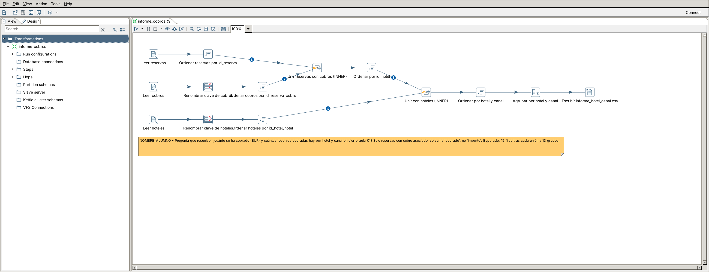
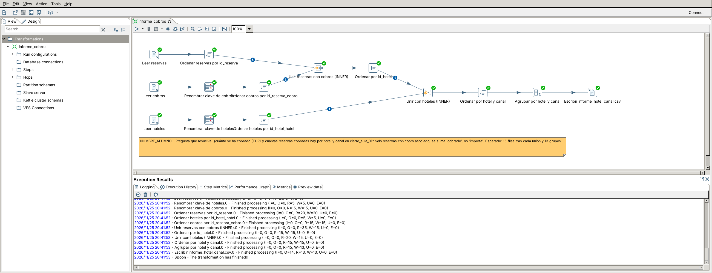
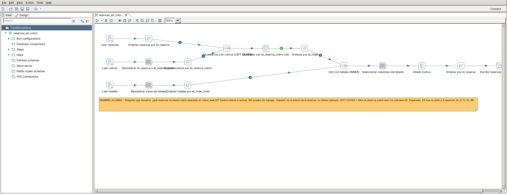
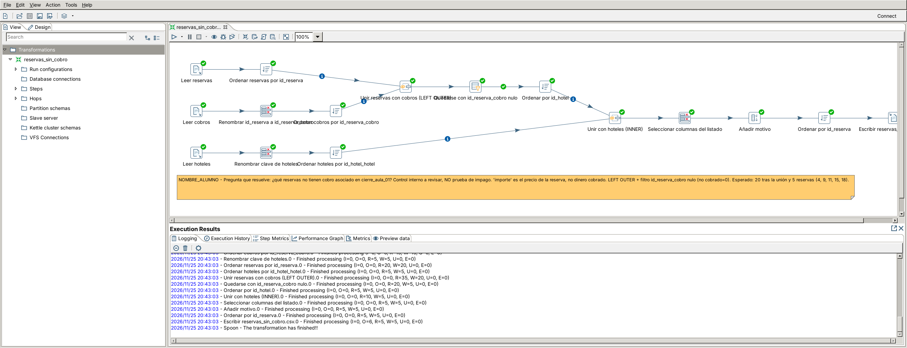
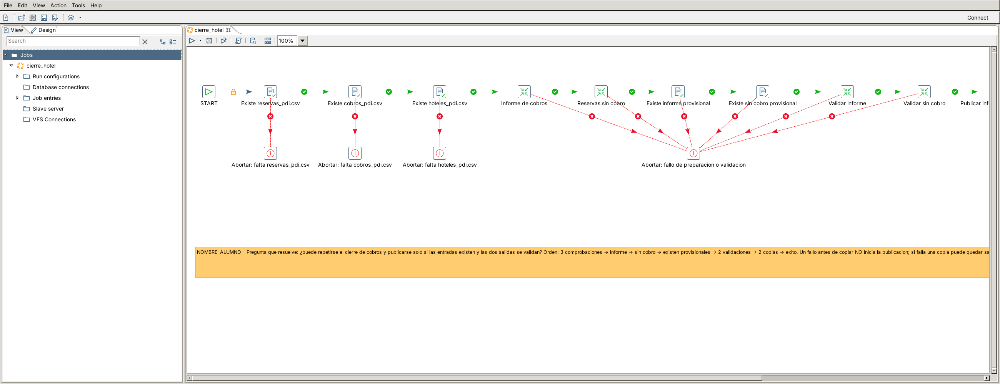
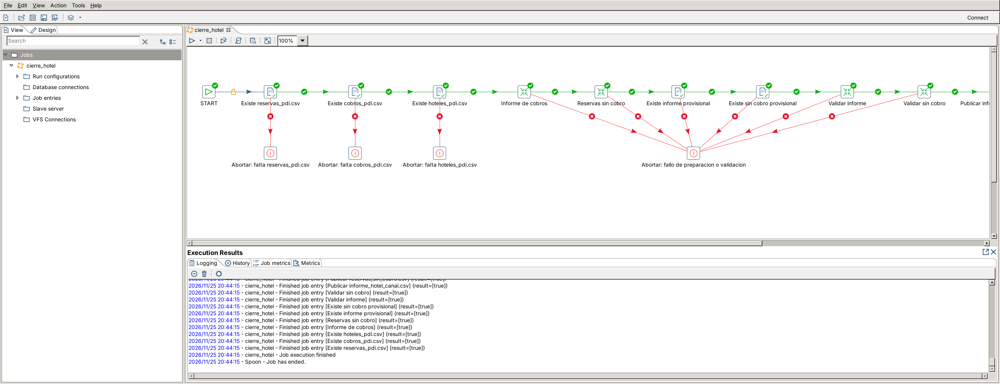

# Guía paso a paso del proyecto (para explicarlo y defenderlo)

Esta guía recorre el proyecto en el orden en que se explica en la defensa: qué problema resuelve, qué datos entran, qué hace cada proceso paso a paso, por qué se hace así y cómo se comprueba. Las imágenes están en [`capturas/`](capturas/) y son capturas reales de Spoon (PDI 9.4.0.0-343).

> **Aviso sobre las capturas.** Se tomaron en una pantalla virtual de Linux. Las notas amarillas del lienzo aún dicen `NOMBRE_ALUMNO`; al sustituirlo por vuestro nombre y volver a guardar en Spoon, conviene repetir las capturas con vuestro equipo.

---

## 1. Qué pide dirección y cómo lo resuelve el proyecto

> «Necesito conocer el importe cobrado y el número de reservas cobradas por hotel y canal. Quiero recibir un CSV claro del cierre y saber qué reservas todavía no tienen un cobro asociado. El procedimiento debe poder repetirse y avisar si no puede generar el informe.»

| Necesidad | Resultado | Cómo se obtiene |
|---|---|---|
| Importe cobrado y nº de reservas cobradas por hotel y canal | `salida/informe_hotel_canal.csv` | `informe_cobros.ktr` |
| Qué reservas no tienen cobro | `salida/reservas_sin_cobro.csv` | `reservas_sin_cobro.ktr` |
| Repetible | Sin *Append*; la copia sustituye el archivo | `cierre_hotel.kjb` |
| Avisar si no puede generar el informe | `Abort` en validaciones y en el job | `validar_*.ktr` + job |

**Idea central en una frase:** *leer → unir por claves → agrupar → escribir en una zona provisional → validar → publicar solo si todo es correcto.*

```
entrada/ (3 CSV originales)
   ↓  informe_cobros.ktr  +  reservas_sin_cobro.ktr
temporal/ (provisionales, no se suben a Git)
   ↓  validar_informe.ktr  +  validar_sin_cobro.ktr
salida/ (publicados)  ←  cierre_hotel.kjb coordina todo
```

Por qué tres carpetas: separar **originales** (nunca se tocan), **provisionales** (se pueden borrar y regenerar) y **publicados** (lo que lee dirección). Si algo falla antes de publicar, `salida/` conserva el último informe bueno.

---

## 2. Los datos de entrada (paquete A008)

| Archivo | Separador | Filas | Qué es una fila |
|---|---|---|---|
| `reservas_pdi.csv` | `,` | 20 | una reserva (`id_reserva`, `id_hotel`, `canal`, `noches`, `importe`) |
| `cobros_pdi.csv` | `;` | 15 | un cobro de una reserva (`id_reserva`, `medio`, `cobrado`) |
| `hoteles_pdi.csv` | `;` | 5 | un hotel (`id_hotel`, `hotel`, `comarca`, `id_cadena`) |

Puntos clave que hay que saber explicar:

- **Cada archivo tiene su propio separador** (la coma en reservas, el punto y coma en los otros dos). Si se usa la misma configuración para los tres, las columnas salen mal.
- **`importe` ≠ `cobrado`.** `importe` es el *precio* de la reserva; `cobrado` es el *dinero que ha entrado*. Se suma `cobrado`.
- **Tipos:** claves (`id_*`, `noches`) como Integer, textos como String, importes como **BigNumber** con punto decimal. Un decimal mal leído (coma frente a punto) no se corrige después al agrupar.
- Hay **15 cobros para 20 reservas** y **como máximo un cobro por reserva**. Todos los hoteles tienen correspondencia. 5 reservas no tienen cobro.
- Las huellas SHA-256 de los tres archivos coinciden con `asignacion.json`: son los originales sin modificar.

---

## 3. `informe_cobros.ktr` — el informe principal



**Pregunta que resuelve:** ¿cuánto se ha cobrado y cuántas reservas cobradas hay por hotel y canal?

| # | Paso | Tipo en Spoon | Qué hace y por qué | Filas |
|---|---|---|---|---|
| 1 | Leer reservas | CSV file input | Separador `,`, UTF-8, cabecera, tipos de la tabla anterior | 20 |
| 2 | Ordenar reservas por id_reserva | Sort rows | *Merge join* necesita las dos entradas ordenadas por la clave | 20 |
| 3 | Leer cobros | CSV file input | Separador `;` | 15 |
| 4 | Renombrar clave de cobros | Select values | `id_reserva` → `id_reserva_cobro`; se queda con `cobrado` y descarta `medio`. Así no hay dos campos llamados igual al unir | 15 |
| 5 | Ordenar cobros por id_reserva_cobro | Sort rows | Orden por la clave de ese lado | 15 |
| 6 | **Unir reservas con cobros (INNER)** | Merge join | Izquierda = reservas, derecha = cobros; `id_reserva = id_reserva_cobro`. INNER: solo reservas **con** cobro | **15** |
| 7 | Ordenar por id_hotel | Sort rows | Preparar la unión con hoteles | 15 |
| 8–10 | Leer hoteles → Renombrar clave (`id_hotel` → `id_hotel_hotel`, se queda con `hotel`) → Ordenar | CSV input + Select + Sort | Misma idea para el lado de hoteles | 5 |
| 11 | **Unir con hoteles (INNER)** | Merge join | Añade el nombre del hotel. Siguen siendo 15: ninguna reserva se pierde | **15** |
| 12 | Ordenar por hotel y canal | Sort rows | *Group by* también necesita la entrada ordenada por los campos de grupo | 15 |
| 13 | **Agrupar por hotel y canal** | Group by | Grupo: `hotel`, `canal`. `SUM(cobrado)` → `cobrado_total`; recuento de `id_reserva` → `n_reservas` | **13** |
| 14 | Escribir informe_hotel_canal.csv | Text file output | Cabecera, `;`, UTF-8, **sin *Append***, importes con `0.00` y punto decimal, columnas `hotel;canal;n_reservas;cobrado_total` | 13 |

### Por qué se ordena antes de *Merge join*
*Merge join* recorre las dos entradas a la vez, ambas ordenadas por la clave. Si no lo están, **no da error: simplemente empareja mal y devuelve filas de menos**. Por eso hay un *Sort rows* delante de cada entrada.

### Por qué 13 filas y no 20
Solo entran las 15 reservas con cobro (INNER). Esas 15 se reparten en **13 combinaciones de hotel y canal** (Comillas web tiene 2 reservas; Laredo web tiene 2). Las 5 reservas sin cobro no están en el informe: van a otro listado.

### Ejecución real


En la pestaña *Step Metrics* se ve el recuento de cada paso: 20 / 15 / 5 leídas, 15 tras cada unión y 13 tras *Group by*.

### Por qué se puede contar filas
Con **como máximo un cobro por reserva**, el cruce no duplica filas y contar filas = contar reservas. Si una reserva tuviera dos pagos, saldrían dos filas: habría que contar reservas *distintas* y sumar los cobros por separado (o agregar los cobros por reserva antes de unir).

---

## 4. `reservas_sin_cobro.ktr` — el control de reservas sin cobro



**Pregunta que resuelve:** ¿qué reservas no tienen cobro asociado en el archivo recibido?

| # | Paso | Qué hace |
|---|---|---|
| 1–5 | Leer reservas, ordenar; leer cobros, renombrar `id_reserva` → `id_reserva_cobro`, ordenar | Igual que antes |
| 6 | **Unir (LEFT OUTER)** | Reservas a la izquierda, cobros a la derecha. **Conserva las 20 reservas**; cuando no hay cobro, los campos de la derecha quedan **nulos** |
| 7 | **Quedarse con `id_reserva_cobro` nulo** (Filter rows) | Se queda con las que no encontraron pareja → **5** |
| 8–11 | Ordenar por `id_hotel`; leer hoteles, renombrar y ordenar; unir INNER | Añade el nombre del hotel (siguen 5) |
| 12 | Seleccionar columnas | `id_reserva`, `hotel`, `canal`, `importe` |
| 13 | Añadir motivo (Add constants) | `motivo = "Sin cobro asociado en el archivo recibido"` |
| 14–15 | Ordenar por `id_reserva` y escribir `temporal/reservas_sin_cobro.csv` | Sobrescribe |

Resultado: reservas **4, 9, 11, 15 y 18**.

### Por qué `id_reserva_cobro` nulo y no `cobrado = 0`
Un cobro de 0 € **sí es un cobro registrado**; la ausencia de cobro es **no tener registro**. Son situaciones distintas. El LEFT OUTER deja los campos de la derecha a nulo exactamente cuando no hay pareja, y por eso el filtro mira la clave y no el importe.

### Qué significa (y qué no) este listado
Es un **control interno para revisar, no una prueba de impago**: una reserva puede tener un pago pendiente o un plazo que estos archivos no describen. Aquí `importe` es el **precio de la reserva**, no dinero cobrado; por eso conserva ese nombre y se explica.



---

## 5. Las dos validaciones

Son transformaciones que **leen el CSV provisional ya escrito** y hacen fallar el proceso si no es correcto. Comprobar sobre el archivo escrito (y no sobre la vista previa) es lo que da garantías.

### `validar_informe.ktr`
`Leer informe provisional` → `Resumen sin claves` → `Constante cien` → `Cobrado en céntimos` → `Filter rows` → (OK) `Write to log` / (no OK) `Abort`.

- **Resumen sin claves** (*Group by* sin campos de grupo): `n_grupos` (*Number of rows*), `suma_reservas` = SUM(`n_reservas`), `suma_cobrado` = SUM(`cobrado_total`).
- **Always give back a result row = activado.** Es la pieza clave: sin ella, un CSV con solo cabecera no produciría **ninguna fila**, nada llegaría a *Abort* y la prueba **pasaría por error**. Con la opción, siempre sale una fila (con 0 grupos y sumas nulas) y el filtro la rechaza.
- **Céntimos:** para comparar el total se multiplica por 100 y se compara con el entero `396550`. Se hace así para no depender de cómo interprete la configuración regional la constante `3965.50` (coma o punto).
- **Filter rows:** exige `n_grupos = 13` **y** `suma_reservas = 15` **y** `total_céntimos = 396550`. Un valor nulo tampoco cumple.
- **Abort** con error y umbral 0: falla en cuanto recibe la **primera** fila.

### `validar_sin_cobro.ktr`
Comprueba el listado de reservas sin cobro: que **todos los identificadores sean los esperados** (4, 9, 11, 15, 18), que **no haya duplicados** (ordena por `id_reserva` y agrupa contando; cada grupo debe tener 1) y que **haya exactamente cinco** (con el mismo resumen sin claves y *Always give back a result row*).

### Límite que hay que reconocer
Los valores (13, 15, 3965.50, ids 4/9/11/15/18) son **de este cierre** (`cierre_aula_01`). En un cierre real variarían: se compararía con totales **calculados desde las entradas**, no con constantes.

---

## 6. `cierre_hotel.kjb` — el job que coordina



El job organiza las tareas y las transformaciones tratan las filas. Orden:

1. **START** → tres `File exists` (reservas, cobros, hoteles). Si falta una → **Abort job** con un mensaje que dice cuál.
2. `informe_cobros.ktr` y, solo si termina bien, `reservas_sin_cobro.ktr`.
3. Dos `File exists` para comprobar que existen los **provisionales**.
4. `validar_informe.ktr` y `validar_sin_cobro.ktr`.
5. **Solo si ambas validaciones pasan**: dos **Copy files** (con sobrescritura) de `temporal/` a `salida/`.
6. Tras las dos copias: **Write to log** («CIERRE CORRECTO…») y **Success**.

Todas las ramas de error de los pasos 2–4 van a un único `Abort job` («fallo de preparación o validación; no se ha iniciado la publicación»). Las dos copias, si fallan, van a un aviso («posible resultado parcial») y a otro `Abort job`.

### Qué impide iniciar la publicación
Falta de una entrada, fallo de una transformación, ausencia de un provisional o fallo de una validación. En todos esos casos **se aborta antes de copiar** y `salida/` conserva el último informe publicado (el job **no borra nada al empezar**).

### Qué pasa si falla una copia
**Copiar dos archivos no es atómico.** Si la primera copia termina y la segunda falla, `salida/` queda con un archivo nuevo y otro anterior o ausente. El job lo avisa («resultado PARCIAL»), **termina con error** y **no anuncia éxito**. La práctica no exige deshacer la primera copia. Una mejora posible sería publicar por versiones y señalar la nueva solo cuando esté completa.



*(La captura corta el lado derecho del job —las dos copias, el registro de éxito y los avisos de resultado parcial— por el ancho de la pantalla virtual; ábrelo en Spoon para verlo entero.)*

### Rutas relativas
Todo usa `${Internal.Transformation.Filename.Directory}` y `${Internal.Job.Filename.Directory}`: no hay rutas propias de ningún equipo, y el proyecto se ejecuta desde cualquier carpeta tras clonarlo. **Hay que guardar el proceso antes de probarlo** para que esas variables se resuelvan.

---

## 7. Las pruebas realizadas (todas con logs reales)

Detalle y extractos en [`pruebas.md`](pruebas.md); logs en [`logs/`](logs/).

| Prueba | Qué se hizo | Resultado real |
|---|---|---|
| 1 Primera ejecución | Sin salidas previas, Kitchen sobre el job | Código 0, `CIERRE CORRECTO` |
| 2 Repetición | Mismas entradas otra vez | Huellas de salida idénticas: **no se acumulan filas** |
| 3 Falta una entrada | Cobros renombrado | Código 1, `FALTA LA ENTRADA…`, `salida/` intacta |
| 4 Salida incompleta | Provisional con solo cabecera | Las dos validaciones fallan (*Abort*, «Row nr 1») |
| 5 Total incorrecto | Laredo web 496.50 → 596.50 | Falla: total 4065.5 ≠ 3965.5 |
| 6 Recuperación | Entradas restauradas, job completo | Código 0, salidas idénticas a la referencia |
| 7 Copia fallida | `salida/` de solo lectura | 1.ª copia correcta, 2.ª `Permission denied`, aviso de resultado **parcial**, código 1, sin éxito |

**Qué demuestra la repetición:** que el procedimiento es *idempotente*: mismas entradas → mismas salidas, sin acumular filas (no hay *Append* y la copia sobrescribe).

**Por qué las pruebas 4 y 5 se ejecutan sobre la validación y no sobre el job completo:** si se lanzara el job, regeneraría el archivo y borraría el fallo que se quiere probar.

---

## 8. Cómo enseñarlo en la defensa (guion de 8–10 minutos)

1. **(1 min)** Explica el encargo y el esquema `entrada → temporal → validar → salida`.
2. **(2 min)** Abre `informe_cobros.ktr`. Recorre de izquierda a derecha. Para en las dos uniones (vista previa: 15 filas) y en *Group by* (13 filas). Muestra `salida/informe_hotel_canal.csv`.
3. **(1 min)** Abre `reservas_sin_cobro.ktr`: LEFT OUTER (20), filtro por clave nula (5). Muestra el CSV.
4. **(2 min)** Abre una validación: resumen sin claves + *Always give back a result row* + *Abort*. Explica qué pasa con un CSV solo con cabecera.
5. **(2 min)** Abre el job: señala las ramas de error. Localiza «la rama que impide publicar» y «la rama del posible estado parcial».
6. **(1 min)** Cierra con los límites: sin ocupación, controles fijos de este cierre, CSV por tamaño.

### Comprobaciones que puede pedir el profesor
- **Seguir la reserva 12** (Santander, `ota`, cobrado 390.00) desde `reservas_pdi.csv` hasta la fila `Santander;ota;1;390.00` del informe.
- **Seguir la reserva 4** (Santander, `web`, 89.90): aparece en `reservas_sin_cobro.csv` y **no** en el informe.
- **Mostrar qué pasa si falta una entrada:** renombrar `cobros_pdi.csv` en una copia y lanzar el job.
- **Explicar qué ocurre si se quita un *Sort rows* delante de un *Merge join*** (menos filas sin aviso).

---

## 9. Preguntas probables con respuesta

- **¿Por qué 13 filas y no 20?** Solo 15 reservas tienen cobro (INNER) y varias comparten hotel y canal.
- **¿Por qué sumar `cobrado` y no `importe`?** `importe` es el precio de la reserva; `cobrado` es el dinero que ha entrado. *(Ojo: con este paquete ambas sumas dan 3965.50, así que no se distingue por el resultado; se defiende por el significado y porque un pago parcial las separaría.)*
- **¿Por qué se ordena antes de *Merge join*?** Recorre las dos entradas a la vez; sin orden empareja mal y no avisa.
- **¿Qué diferencia hay entre INNER y LEFT OUTER aquí?** INNER deja solo reservas con cobro (15, informe); LEFT OUTER conserva las 20 y deja nulos los campos de cobro en las 5 sin cobro (control).
- **¿Por qué filtrar por clave nula y no `cobrado = 0`?** Cobro de cero ≠ cobro ausente.
- **¿Qué demuestra la repetición?** Idempotencia: sin duplicados.
- **¿Qué fallos impiden iniciar la publicación?** Entrada ausente, fallo de transformación, provisional ausente, fallo de validación.
- **¿Qué puede ocurrir si falla una copia?** Resultado parcial en `salida/`; el job avisa y falla, nunca anuncia éxito.
- **¿Por qué un CSV con solo cabecera debe fallar?** *Always give back a result row* fuerza una fila con 0 y *Abort* (umbral 0) falla al recibirla.
- **¿Por qué CSV?** Pequeño, legible por cualquier herramienta, versionable. Para un histórico grande consultado por columnas: Parquet (columnar, comprimido).
- **¿Por qué este informe no mide ocupación?** Faltan habitaciones disponibles y ocupadas por periodo (y fechas de estancia).
- **¿Y con 500 GB?** Habría que revisar la ordenación en memoria/disco de *Sort rows*, el tiempo de lectura de CSV (formato columnar, particionado) y si cabe en la ventana de madrugada, antes de pensar en un clúster (UT2).

---

## 10. Cosas que debes saber reconocer con honestidad

- **Los procesos se generaron con ayuda de IA** y están declarados así en el README. En la defensa tienes que poder explicar cada paso con tus palabras; esta guía está para eso.
- **Los valores de control son fijos** (13, 15, 3965.50…): sirven para este cierre, no para uno real.
- **Con este paquete `cobrado` = `importe`**: no se puede demostrar con cifras que se suma `cobrado`.
- **La publicación no es atómica** y la práctica no lo exige.
- Ejecutado con Kitchen/Pan 9.4.0.0-343 y OpenJDK 11 en Linux; repite la ejecución en tu equipo antes de entregar.
